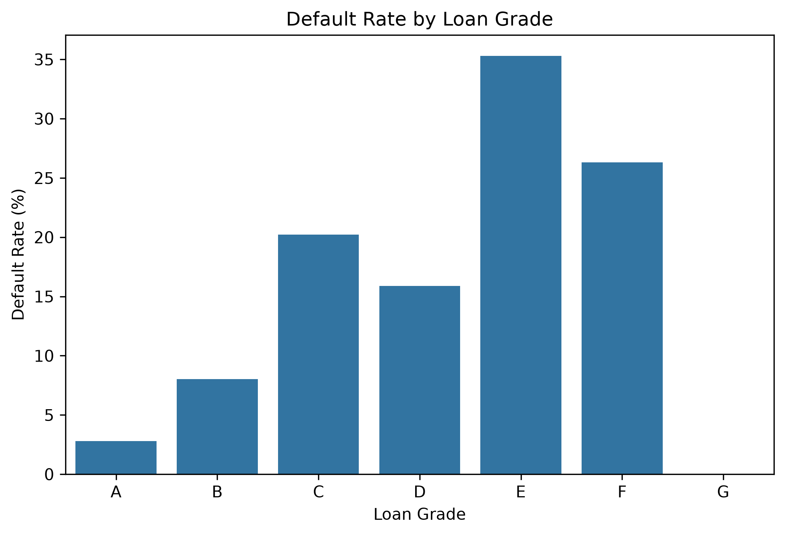
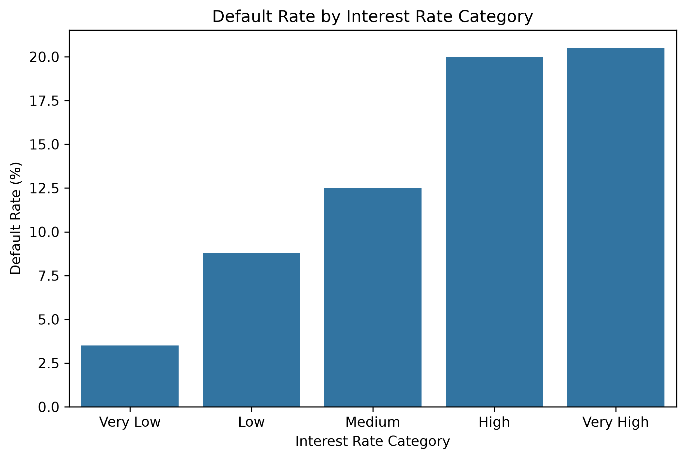
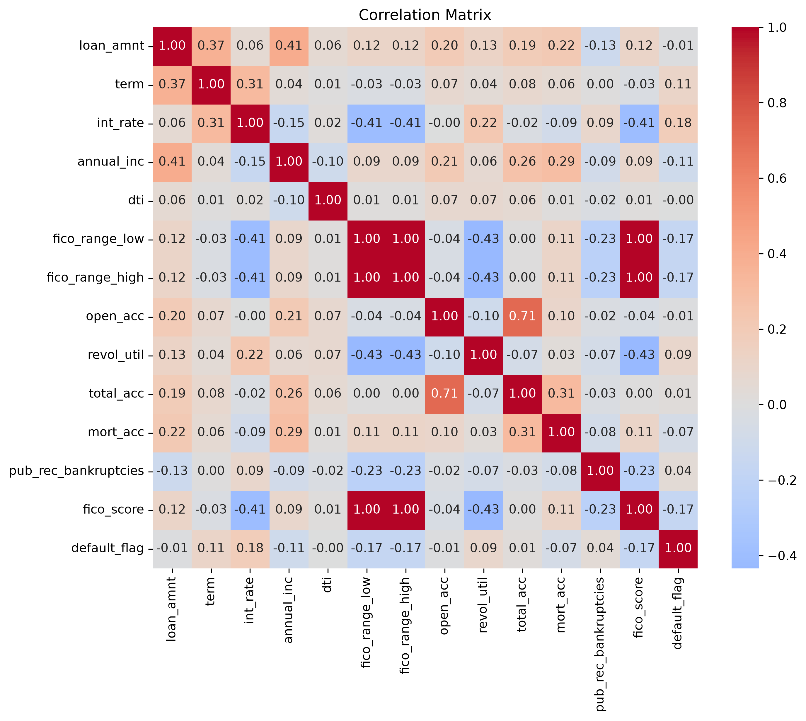
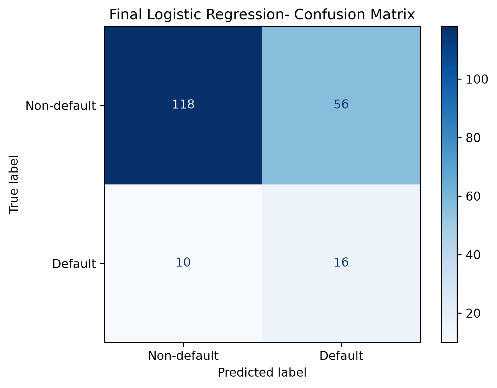
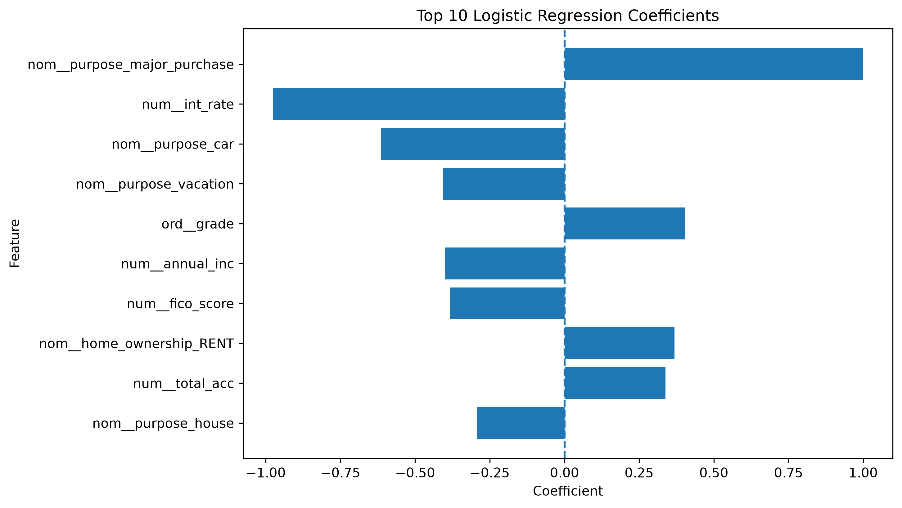

# Credit Risk Analysis

This project analyzes Lending Club loan data to explore factors related to credit default risk and build a model for predicting whether a borrower will default.

The dataset contains 1,000 loans and includes information about the loan itself, the borrower's financial situation and credit history. Since only 13% of the loans in the dataset are defaults, particular attention was given to class imbalance and to choosing appropriate evaluation metrics.

The project covers the full process from data cleaning and exploratory data analysis to preprocessing, model comparison, threshold selection and final model interpretation.

## Dataset

The dataset is a sample of Lending Club loan data containing 1,000 observations.

The target variable used for modeling is `default_flag`:

- `0` – non-default
- `1` – default

The target distribution is approximately 87% non-default and 13% default.

The predictors include loan characteristics and borrower information such as loan amount, term, interest rate, loan grade, employment length, annual income, debt-to-income ratio, revolving credit utilization and FICO score.

Variables that directly reveal the final loan outcome were excluded from the model to avoid data leakage.

## Exploratory Data Analysis

The exploratory analysis focused on understanding the distribution of the data and examining how borrower and loan characteristics are related to default.

Some of the main patterns observed were:

- lower FICO scores were associated with higher default rates
- lower annual income was generally associated with higher default risk
- higher-risk loan grades showed higher default rates
- interest rate was positively associated with default risk
- the relationship between loan amount and interest rate was relatively weak

### Default Risk by Loan Grade



Default rates generally increase for higher-risk loan grades, although the pattern is not perfectly monotonic. The smaller number of loans in the highest-risk grades should also be considered when interpreting these differences.

### Default Risk by Interest Rate



Loans with higher interest rates showed higher default rates in the sample, suggesting a clear relationship between interest rate and credit risk.

### Correlation Analysis



The correlation matrix shows several relationships between the numerical variables. Interest rate and FICO score are both associated with default, while some predictors are also strongly related to each other.

The analysis also showed that some predictors, particularly interest rate, grade and sub-grade, contain related information about borrower risk.

## Data Preparation

The data contains numerical, ordinal and nominal features, so different preprocessing methods were used for each group.

Numerical features were standardized using `StandardScaler`. Ordered categorical variables such as grade, sub-grade and employment length were transformed using `OrdinalEncoder`, while nominal variables such as home ownership, verification status and loan purpose were transformed using one-hot encoding.

The data was split into 80% training data and 20% test data using stratification to preserve the proportion of defaults in both sets.

All preprocessing steps were combined with the models using scikit-learn pipelines.

## Model Development

Three classification models were compared:

- Logistic Regression
- Decision Tree
- Random Forest

Model selection was based primarily on ROC-AUC because the target variable is imbalanced and accuracy alone can give a misleading picture of model performance.

Five-fold stratified cross-validation was performed on the training data.

| Model | Mean CV ROC-AUC |
|---|---:|
| Logistic Regression | 0.703 |
| Random Forest | 0.700 |
| Decision Tree | 0.685 |

For the Decision Tree and Random Forest, tree depth was evaluated using cross-validation to control overfitting. The best tested values were `max_depth=4` for the Decision Tree and `max_depth=3` for the Random Forest.

A Logistic Regression model with balanced class weights was also tested, but it did not improve the mean cross-validation ROC-AUC.

Logistic Regression was selected as the final model because it achieved the highest cross-validation ROC-AUC while also being simpler and easier to interpret.

## Classification Threshold

Using the default classification threshold of 0.50, Logistic Regression classified every observation in the test set as non-default. This resulted in an accuracy of 87%, but recall for the default class was 0.

This illustrates why accuracy is not sufficient for evaluating this problem.

Different classification thresholds were evaluated using out-of-fold predictions from the training data rather than the test set. Among the tested values, a threshold of 0.15 produced the highest F1-score and provided a better balance between identifying defaults and limiting false positives.

The selected threshold was then applied to the test set for the final evaluation.

## Final Model Results

The final Logistic Regression model achieved the following results on the test set using a classification threshold of 0.15:

| Metric | Score |
|---|---:|
| ROC-AUC | 0.734 |
| Accuracy | 0.670 |
| Precision | 0.222 |
| Recall | 0.615 |
| F1-score | 0.327 |


### Final Confusion Matrix



The final confusion matrix was:

| | Predicted Non-default | Predicted Default |
|---|---:|---:|
| Actual Non-default | 118 | 56 |
| Actual Default | 10 | 16 |

### Final Confusion Matrix


The model correctly identified 16 of the 26 defaulted loans. The higher recall compared with the default 0.50 threshold comes at the cost of more false positives, with 56 non-default borrowers classified as risky.

In a real credit risk setting, the final threshold would depend on the relative cost of missing a borrower who will default and incorrectly classifying a reliable borrower as high-risk.

## Model Interpretation

Logistic Regression coefficients were examined to understand how the model uses different features.



Higher FICO scores and annual income were associated with lower predicted default risk, while worse loan grades and renting a home were associated with higher predicted risk.

Individual coefficients should not be interpreted as causal effects. Some predictors, especially interest rate, grade and sub-grade, are strongly related to each other, which can affect the size and direction of individual Logistic Regression coefficients.

## Limitations

This project uses a relatively small sample of 1,000 loans, including only 130 defaults. As a result, model performance can vary depending on the particular observations used for training and validation.

The dataset is also imbalanced, which makes default prediction more difficult and requires metrics beyond accuracy.

Some predictors, such as interest rate, grade and sub-grade, reflect related aspects of Lending Club's own risk assessment. This should be considered when interpreting the model and its coefficients.

The model is intended as an exploratory credit risk classification project rather than a production credit scoring system.

## Tools

- Python
- pandas
- NumPy
- Matplotlib
- Seaborn
- scikit-learn
- Jupyter Notebook

## Project Structure

```text
credit-risk-analysis/
├── data/
│   └── lending_club_clean_sample.csv
├── images/
├── notebooks/
│   └── 01_credit_risk_analysis.ipynb
├── .gitignore
├── README.md
└── requirements.txt
```

## How to Run the Project

Clone the repository and install the required Python packages:

```bash
pip install -r requirements.txt
```

Then open:

```text
notebooks/01_credit_risk_analysis.ipynb
```

and run the notebook from top to bottom.